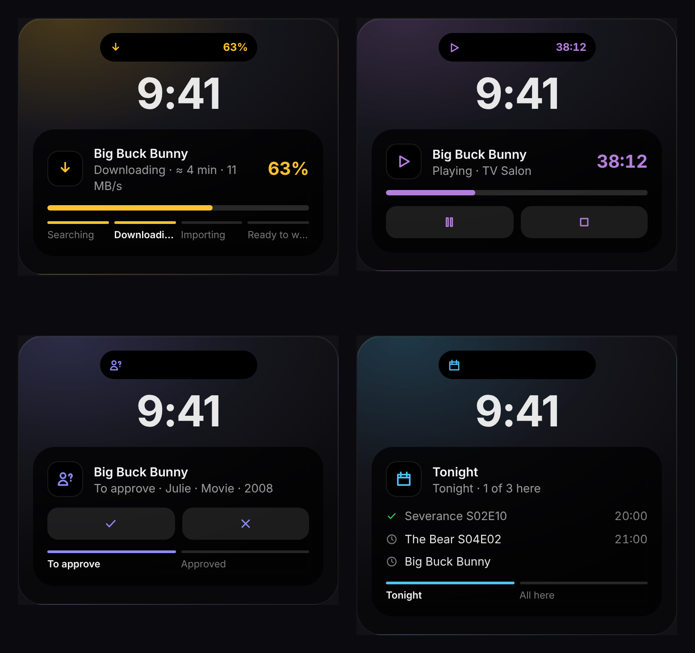

<div align="center">


# Quai

**Your Radarr, Sonarr and Jellyfin, live on your iPhone's Lock Screen.**

[](https://github.com/mathieuletyrant/quai-app/pkgs/container/quai)


[](LICENSE)

</div>

<p align="center"></p>

You request a movie. Quai puts it on your Lock Screen and in the Dynamic Island, and keeps it up
to date while the app is closed: searching, downloading (percent, speed, time left), importing,
ready to watch.

> [!NOTE]
> Quai works today on my own setup. The iPhone app is on TestFlight only, iPhone only. Expect rough edges.

## ✨ What it does

**Live Activities**
- ⬇️ **Download**: from the request to "ready to watch", with live progress from qBittorrent.
- ▶️ **Playback**: what's playing on Jellyfin, time left, and Play/Pause from the Lock Screen.
- 🙋 **Requests**: a Seerr request waiting for your approval, with Approve and Decline buttons.
- 📅 **Today**: one activity for the day, ticking off today's episodes and movies as they arrive.
- 🚨 **Incidents**: a service that stops answering.

You choose which ones run, and what each step shows, in a small flow editor in the web console.
The app is for living with Quai, the console for setting it up: services, flows and iPhones, plus the journal of what Quai did.

**The app**
- 🏠 **Home**: what's downloading, what's ready, today's releases, requests waiting for you, what happened lately and how full the disk is.
- 🎞️ **Library**: your movies and series with their posters, and what's still missing.
- 🛠️ **To fix**: blocked imports (remove or import anyway), titles with no release (search and pick
  one), and what Reclaimerr is about to delete (keep it).

## 🧭 How it works

Quai has two parts.

- 🏠 **Quai Home** runs next to your services, on your server. It holds their API keys and your data
  (paired iPhones, flows, preferences). It sets up the Radarr and Sonarr webhooks, polls only
  what's needed, and makes only the calls on a fixed allowlist. It connects out: no port to open.
- ☁️ **Quai Cloud** turns what Home sends into Live Activities and pushes them through Apple. It
  stores nothing: when Home connects, Cloud loads what it needs from it.

```
 your server                                   anywhere
┌───────────────────────────────┐         ┌─────────────────┐          ┌────────┐
│ Radarr · Sonarr · qBittorrent │         │                 │  Apple   │        │
│ Jellyfin · Seerr · Reclaimerr │         │   Quai Cloud    │ ───────▶ │ iPhone │
│              ▲                │ ──────▶ │ (stores nothing)│ ◀─────── │        │
│              │                │ ◀────── │                 │   app    │        │
│          Quai Home            │         └─────────────────┘          └────────┘
│      (your keys, your data)   │
└───────────────────────────────┘
```

A Play/Pause tap on the Lock Screen goes iPhone → Cloud → Home, and Home calls Jellyfin.

Today both parts run on your own server. A hosted Cloud, so you only run Home, is planned
([spec](docs/spec-v2-hosted.md)).

## 🚀 Install

☂️ **Umbrel**: install **Quai** from [Mathieu's Umbrel App Store](https://github.com/mathieuletyrant/umbrel-community-app-store),
paste your API keys in its settings, open it and scan the QR code with the iPhone.

🐳 **Docker**: run both images side by side.

```yaml
services:
  cloud:
    image: ghcr.io/mathieuletyrant/quai:latest
    ports: ["8787:8787"]
    environment:
      QUAI_APNS_KEY_FILE: /keys/AuthKey.p8
      QUAI_APNS_KEY_ID: ABCDE12345
      QUAI_APNS_TEAM_ID: FGHIJ67890
    volumes: ["./keys:/keys:ro"]
  home:
    image: ghcr.io/mathieuletyrant/quai-home:latest
    environment:
      QUAI_CLOUD_URL: ws://cloud:8787/home
      QUAI_INTERNAL_URL: http://home:8788
      QUAI_RADARR_URL: http://radarr:7878
      QUAI_RADARR_API_KEY: ...
      QUAI_SONARR_URL: http://sonarr:8989
      QUAI_SONARR_API_KEY: ...
    volumes: ["./data:/data"]
```

Then open `http://<server>:8787`, choose **Pair an iPhone** and scan the code.

Live Activities need an Apple push key, and Apple only accepts pushes signed with the key of the
app's own developer account. Until the hosted Cloud exists, self-hosting means building the app with
your own account.

<details>
<summary>All settings</summary>

**Quai Home**

| Env | |
|---|---|
| `QUAI_CLOUD_URL` | The Cloud's WebSocket, e.g. `ws://cloud:8787/home` |
| `QUAI_INTERNAL_URL` | How Radarr and Sonarr reach Home, for the webhooks it sets up |
| `QUAI_DATA_DIR` | Where Home keeps its data (default `./data`, `/data` in the image) |
| `QUAI_RADARR_URL`, `QUAI_RADARR_API_KEY` | Radarr (Settings → General) |
| `QUAI_SONARR_URL`, `QUAI_SONARR_API_KEY` | Sonarr (Settings → General) |
| `QUAI_JELLYFIN_URL`, `QUAI_JELLYFIN_API_KEY` | Jellyfin (Dashboard → API Keys) |
| `QUAI_QBITTORRENT_URL`, `QUAI_QBITTORRENT_USERNAME`, `QUAI_QBITTORRENT_PASSWORD` | qBittorrent Web UI |
| `QUAI_SEERR_URL`, `QUAI_SEERR_API_KEY` | Seerr, Jellyseerr or Overseerr (Settings → General) |
| `QUAI_PROWLARR_URL`, `QUAI_PROWLARR_API_KEY` | Prowlarr (Settings → General), for the alerts only |
| `QUAI_RECLAIMERR_URL`, `QUAI_RECLAIMERR_API_KEY` | Reclaimerr (Settings → Integrations) |

A service without its URL and key is skipped.

**Quai Cloud**

| Env | Default | |
|---|---|---|
| `QUAI_PORT` | `8787` | API, console and the `/home` WebSocket |
| `QUAI_APNS_KEY_FILE` (or `QUAI_APNS_KEY`), `QUAI_APNS_KEY_ID`, `QUAI_APNS_TEAM_ID` | | Apple push key (.p8) |
| `QUAI_APNS_TOPIC` | `com.mathieuletyrant.quai` | The app's bundle id |
| `QUAI_PUBLIC_URL` | | Address from outside, added to the pairing QR code |
| `QUAI_PUBLIC_HEADERS` | | Headers your reverse proxy requires from the app ([docs](docs/proxy.md)) |
| `QUAI_TZ` | `UTC` | Time zone for "today", until an iPhone reports its own |
| `QUAI_HOME_ID` | | The only Quai Home served (the id it logs as `linked as home …`); any other is refused ([docs](docs/proxy.md#quai_home_id)) |

</details>

## 🛠️ Develop

```sh
pnpm install
pnpm dev:cloud     # Quai Cloud on :8787
pnpm dev:console   # console on :5173
pnpm check && pnpm test
```

| Path | |
|---|---|
| `packages/api` | The contract (Effect `HttpApi` + `Schema`), exported as `openapi.json` |
| `apps/home` | Quai Home |
| `apps/cloud` | Quai Cloud (Effect on Node) |
| `apps/console` | Web console (React, Vite) |
| `apps/ios` | iPhone app and Live Activities (SwiftUI, XcodeGen) |

iOS: `cd apps/ios && xcodegen generate && open Quai.xcodeproj`.

Releases are automatic from [Conventional Commits](https://www.conventionalcommits.org): merging
the release PR publishes the Docker images and uploads the app to TestFlight.

📖 More: [flows](docs/flows.md) · [Home and Cloud](docs/spec-v2-hosted.md) · [behind a proxy](docs/proxy.md) · [rules for coding agents](AGENTS.md)

## 📄 License

[Apache 2.0](LICENSE). The **Quai** name and logo aren't covered by it ([TRADEMARKS.md](TRADEMARKS.md)):
a fork you ship to others needs its own name, logo and bundle id.
