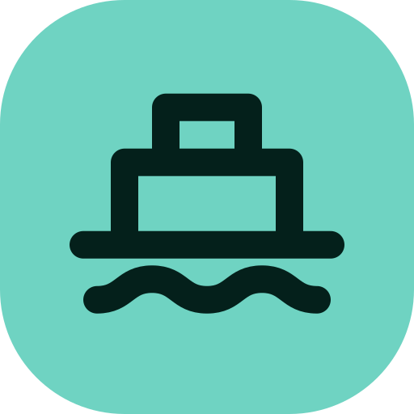

<div align="center">



# Quai

**Your self-hosted media stack, live on your iPhone.**
Every movie or series followed from request to "ready to watch", on the Lock Screen and in the Dynamic Island.

[](https://github.com/mathieuletyrant/quai-app/pkgs/container/quai)


</div>

> [!NOTE]
> Early days. The server, console and iOS app are scaffolded; the first Live Activity (Download) is the next milestone.

## ✨ Features

**Live Activities**, started remotely by the server, with the app closed:

- ⬇️ **Download**: search, download (%, speed, time left), import, French subtitles, available. Then "Play on TV" for 15 min
- ▶️ **Jellyfin playback**: title, time left, end time, on the devices you pick
- 📅 **Today's releases**: what airs today with a countdown, ticked off once grabbed
- 🚨 **Server incident**: a service, indexer or disk down, since when, what's waiting

**Server**

- 🔌 Reads Radarr, Sonarr, Prowlarr, Bazarr, qBittorrent, Seerr and Jellyfin over your Docker network
- 🪝 Sets up its own webhooks, polls only while an activity needs it
- 🔒 Local first: nothing leaves the machine but the pushes to Apple; no port to open
- 🖥️ Web console: guided setup, Live Activity rules, paired iPhones, event log

**iPhone app**

- 📷 Pair by scanning a QR code from the console
- 📋 Live activities first, then today's events
- 🎚️ One switch per activity kind, greyed out when the admin turned it off

## 🚀 Run it

```sh
docker run -d --name quai -p 8787:8787 -v ./data:/data \
  --network <your-arr-network> \
  ghcr.io/mathieuletyrant/quai:latest
```

Open http://localhost:8787. Quai must share a Docker network with the *arr apps so it can reach them by container name. See [`docker-compose.example.yml`](docker-compose.example.yml).

| Env | Default | |
|---|---|---|
| `QUAI_PORT` | `8787` | HTTP port (API + console) |
| `QUAI_DATA_DIR` | `/data` | SQLite database (paired iPhones, webhook secret) |
| `QUAI_CONSOLE_DIR` | `/app/console` | Built console served by the server |
| `QUAI_INTERNAL_URL` | – | How Radarr and Sonarr reach Quai, e.g. `http://quai:8787`. Set it and Quai adds its webhook to them on start |
| `QUAI_PUBLIC_URL` | – | Address from outside (behind Cloudflare Access, say), added to the pairing QR code |
| `QUAI_RADARR_URL`, `QUAI_RADARR_API_KEY` | – | Radarr |
| `QUAI_SONARR_URL`, `QUAI_SONARR_API_KEY` | – | Sonarr |
| `QUAI_QBITTORRENT_URL`, `QUAI_QBITTORRENT_USERNAME`, `QUAI_QBITTORRENT_PASSWORD` | – | qBittorrent Web UI (user and password optional with its local auth bypass) |
| `QUAI_JELLYFIN_URL`, `QUAI_JELLYFIN_API_KEY` | – | Jellyfin, to know when a title is ready |
| `QUAI_APNS_KEY_FILE` (or `QUAI_APNS_KEY`), `QUAI_APNS_KEY_ID`, `QUAI_APNS_TEAM_ID` | – | Apple push key (.p8) for Live Activities. Easier: upload it in the console, where it's stored encrypted and wins over these |
| `QUAI_APNS_TOPIC` | `com.mathieuletyrant.quai` | The iOS app's bundle id |

The console's guided setup will replace most of these.

The image is multi-arch (amd64 / arm64), tagged `latest`, `x.y` and `x.y.z`.

On Umbrel, install **Quai** from [Mathieu's Umbrel App Store](https://github.com/mathieuletyrant/umbrel-community-app-store).

## 🛠️ Develop

```sh
pnpm install
pnpm dev:server      # API on :8787
pnpm dev:console     # console on http://localhost:5173
pnpm test
pnpm check
pnpm gen:openapi     # after changing packages/api
```

```
packages/api     The contract: Effect HttpApi + Schema, exported as openapi.json
apps/server      Effect 4 on Node: *arr adapters, activity engine, APNs over HTTP/2
apps/console     React · Vite, typed client derived from packages/api
apps/ios         SwiftUI · WidgetKit Live Activities · App Intents (XcodeGen project.yml)
```

One contract, three consumers: changing a route in `packages/api` breaks the server, the console and the iOS app at compile time.

iOS (macOS): `cd apps/ios && xcodegen generate && open Quai.xcodeproj`. The **Quai Demo** scheme starts a demo Live Activity without a server.

### 📦 Releases

Fully automatic, driven by [Conventional Commits](https://www.conventionalcommits.org) (`feat:` → minor, `fix:` → patch):

1. Every push to `main` opens or updates a **release PR** with the next version and the CHANGELOG.
2. Merging it creates the tag and GitHub release, then builds and publishes the Docker image.
3. The same release is archived and uploaded to TestFlight, once the repo has the `ASC_KEY_P8` secret: the .p8 of the App Store Connect API key (Admin role, which cloud signing needs) whose ids are in `.github/workflows/testflight.yml`.

📖 Spec: [docs/spec-v1.md](docs/spec-v1.md) · 🤖 Agent rules: [AGENTS.md](AGENTS.md)
